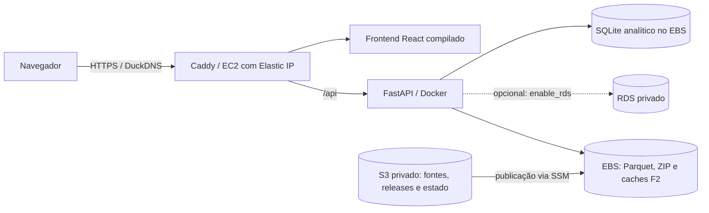

# Publicação AWS econômica — FireCal Global

Configuração preparada para **Norte da Virgínia (`us-east-1`)** e
**`firecalglobal.duckdns.org`**. Os comandos abaixo partem da raiz
`nasa-hackaton-repo`. A criação dos recursos depende de autenticação, revisão do
`plan` e execução de `apply`; escrever estes arquivos não publica o sistema.

**Perfil atual: `t3.micro` + SQLite + S3, sem RDS**, por decisão de custo.
Estimativa recorrente de aproximadamente **US$ 15/mês**, antes de tráfego,
requisições, impostos e crescimento do armazenamento. A variante RDS permanece
opcional, com `enable_rds = true`; não é criada no perfil padrão.
Veja [custos e alternativas de banco](CUSTOS.md).

Para retomar o ambiente já publicado, recuperar estado, fazer backup,
restaurar uma release ou corrigir o bootstrap, consulte [OPERACAO.md](OPERACAO.md).
O [registro da implantação](../docs/relatorios/implantacao-aws-economica.md)
identifica os recursos e as verificações realizadas.

## Antes de começar

O publicador foi preparado para Linux com Docker e Python **3.12.2**. Ele
constrói imagens **Linux AMD64** localmente; esse é o perfil da EC2 `t3.micro`.
Uma troca para instância ARM exige adaptar e validar AMI, imagens e bootstrap.

Na máquina de publicação, tenha Git, AWS CLI v2, Docker Engine com buildx,
Node.js 22 se for executar o frontend fora do Docker, `uv` e Python 3.12.2.
O build de produção usa Node 22 dentro da imagem, portanto Node local não é
necessário para executar apenas `infra/scripts/deploy.py`.

Depois de clonar o repositório e entrar em `nasa-hackaton-repo`, prepare o
ambiente Python **somente se ele ainda não existir**:

```bash
if [ ! -x ../.venv/bin/python ]; then
  uv venv --python 3.12.2 ../.venv
fi
../.venv/bin/python --version
uv pip install --python ../.venv/bin/python -r backend/requirements.txt
docker version
docker buildx version
```

Confirme Python 3.12.2 antes de continuar. Não substitua silenciosamente por
outra versão. O host Ubuntu usa seu Python de sistema apenas para tarefas
administrativas; o backend executa Python 3.12.2 na imagem.

O Git não inclui os dados. Para uma instalação nova, disponibilize a base
existente em `../data` ou informe `--data-root`. Para recuperar a base do bucket
privado de um ambiente existente, use o procedimento em `OPERACAO.md`. Não é
necessário baixar novos produtos NASA para repetir esta implantação.

Se o ambiente AWS já existe, recupere o estado antes de executar qualquer
`apply`. Os passos de criação do bucket abaixo são para um ambiente novo.

## Arquitetura recomendada



O frontend estático e o backend ficam na mesma EC2 inicialmente. Caddy serve os
arquivos compilados e encaminha `/api`, usando a mesma origem e certificados
HTTPS automáticos. Isso dispensa Load Balancer, NAT Gateway e uma distribuição
CloudFront nesta primeira implantação. Caso o tráfego cresça, o frontend pode
migrar para S3/CloudFront e a API ganhar balanceamento, usando outro desenho de
domínio e certificado.

Quando habilitado explicitamente, o **RDS é usado de fato** por `/explore/countries`, `/explore/query`,
`/explore/map` e `/explore/status`: recebe o cubo mensal/anual, inventário de
células e disponibilidade, no schema `firecal_analytics`. A migração usa COPY e
publica um snapshot transacional. Consultas semanais/detalhadas, reconstrução
diária dos ZIPs originais e inferência F2 continuam usando Parquet e caches no
EBS. Não se importam automaticamente os 295 milhões de registros de 1 km para
o RDS. Veja [o contrato PostgreSQL](../backend/docs/RDS.md).

O F2 continua sendo uma projeção experimental com referência histórica em
2024–2025. A publicação não transforma essa projeção em previsão para a data
atual nem altera os dados científicos.

| Recurso | Padrão inicial |
| --- | --- |
| EC2 | Ubuntu 24.04 AMD64, `t3.micro`, 2 vCPU / 1 GiB, CPU Standard |
| Backend | Python **3.12.2**, um worker, uma consulta pesada por vez, limite 700 MiB + swap |
| Frontend | build Node 22, arquivos estáticos no Caddy 2 |
| RDS | Desativado; opcional PostgreSQL 17, `db.t4g.micro`, Single-AZ |
| Disco do RDS | gp3 criptografado, 20 GiB, crescimento até 100 GiB |
| Backups do RDS | 7 dias, proteção de exclusão, snapshot final obrigatório |
| Disco da EC2 | raiz 10 GiB e EBS de dados 30 GiB, criptografados, swap 3 GiB no EBS |
| Dados de origem | aproximadamente 13,74 GiB / 148 arquivos nesta base |
| Entrada pública | somente TCP 80 e 443; API 8000 e banco 5432 privados |
| Administração | Systems Manager; nenhuma chave SSH necessária |

EC2, EBS, IPv4 público, S3 e transferência têm cobrança. RDS e Secrets Manager só são criados se habilitados.
Não se presume gratuidade. Confira tamanhos, quotas e estimativa na conta antes
do `apply`. Single-AZ e uma EC2 constituem pontos únicos de indisponibilidade.
O EBS preserva dados na troca da instância; não substitui uma política de backup.
Fontes, releases e snapshot consistente do SQLite ficam no S3. Não se abre SQLite diretamente no S3: a API consulta uma cópia local.

## 1. Login no AWS CLI

O AWS CLI desta máquina já é v2.36.15. O login pelo navegador exige v2.32 ou
superior. Use um perfil próprio, preservando o perfil da empresa:

```bash
aws --version
aws login --profile firecal
aws configure set region us-east-1 --profile firecal
aws sts get-caller-identity --profile firecal
```

No navegador, autentique na **conta pessoal** e autorize o acesso. Confira o
campo `Account` do STS. Não envie senha, access key, session token ou token
DuckDNS no chat. Se o navegador estiver em outra máquina:

```bash
aws login --profile firecal --remote
```

A identidade IAM/federada precisa da política `SignInLocalDevelopmentAccess`
para esse fluxo de login. Isso autoriza a autenticação, mas as permissões de
provisionamento são separadas. Se houver erro de autorização de login, ajuste
a política com o administrador da conta pessoal. Prefira identidade com MFA.

Se a conta usa **IAM Identity Center**, substitua o login anterior por:

```bash
aws configure sso --profile firecal
aws sso login --profile firecal
aws sts get-caller-identity --profile firecal
```

Informe a URL inicial/Issuer URL e a região do Identity Center fornecidas pela
conta. A região do Identity Center pode diferir da região do projeto.

Para o Terraform consumir as credenciais temporárias do novo `aws login`,
configure a ponte recomendada pela AWS:

```bash
aws configure set credential_process \
  "aws configure export-credentials --profile firecal --format process" \
  --profile firecal-terraform
aws configure set region us-east-1 --profile firecal-terraform
aws sts get-caller-identity --profile firecal-terraform
export AWS_PROFILE=firecal-terraform
```

Não execute `export-credentials` isoladamente: ele imprime credenciais. Aqui
ele é executado internamente pelo SDK, sem ser exibido. O perfil de origem e
o perfil de destino precisam ser distintos para evitar recursão.

O provisionador precisa de permissões para VPC/subnets/security groups, EC2/EBS/
EIP, RDS/subnet/parameter groups, S3 e suas configurações, IAM role/policies/
instance profile/PassRole, Secrets Manager e SSM. A publicação também requer
`ssm:PutParameter`, `GetParameter`, `SendCommand`, `GetCommandInvocation`, acesso
aos objetos S3 e bloqueio do estado. Uma sessão somente de leitura não basta.
No perfil econômico não são necessárias permissões para criar RDS ou Secrets Manager.
As permissões da **EC2** são mais restritas e definidas no Terraform.
O deploy também precisa de leitura/gravação no bucket e dos comandos locais
Docker. Nenhuma porta SSH pública ou chave de acesso permanente é necessária.

## 2. Terraform e configuração da conta

O Terraform global 1.9.8 é antigo para o bloqueio nativo de estado usado aqui.
O instalador baixa Terraform 1.17.2 da HashiCorp, confere SHA-256 e grava apenas
em `infra/.tools/`. O wrapper `infra/tf` usa essa cópia, preservando a instalação
global. Os módulos exigem Terraform >= 1.11 e < 2.

```bash
# Se estiver neste workspace: o Python está na raiz do repositório principal.
../.venv/bin/python infra/scripts/install_terraform.py
chmod +x infra/tf
infra/tf version
cp infra/terraform/terraform.tfvars.example infra/terraform/terraform.tfvars
```

Edite `infra/terraform/terraform.tfvars`: substitua `123456789012` pelo ID da
conta pessoal confirmado no STS. Ajuste `artifact_bucket` para
`firecalglobal-SEU_ID_DA_CONTA-us-east-1`. O provider bloqueia execução em uma
conta diferente de `expected_account_id`.

Crie também `infra/bootstrap/terraform.tfvars`:

```hcl
aws_profile         = "firecal-terraform"
aws_region          = "us-east-1"
expected_account_id = "SEU_ID_DE_12_DIGITOS"
project_name        = "firecalglobal"
```

Não coloque segredos em nenhum desses arquivos. Arquivos `*.tfvars`, planos,
estado, backend local e ferramentas baixadas são ignorados pelo Git.

## 3. Bucket privado e estado remoto

O bucket precisa existir antes de inicializar o backend S3 do módulo principal.
O módulo `bootstrap` cria um bucket com versionamento, criptografia, acesso
público bloqueado e exigência de TLS. Ele recebe estado em `state/`, código em
`releases/` e fontes em `data/`. A EC2 só acessa `releases/` e `data/`.

```bash
infra/tf -chdir=infra/bootstrap init
infra/tf -chdir=infra/bootstrap plan -out=bootstrap.tfplan
# Confira a conta, bucket e custos antes do próximo comando.
infra/tf -chdir=infra/bootstrap apply bootstrap.tfplan
infra/tf -chdir=infra/bootstrap output bucket_name

cp infra/terraform/backend.hcl.example infra/terraform/backend.hcl
```

Edite `backend.hcl` com o bucket criado, mantendo `region = "us-east-1"`,
`profile = "firecal-terraform"`, `encrypt = true` e `use_lockfile = true`.
Esse bloqueio usa o próprio S3, sem tabela DynamoDB. Guarde uma cópia segura do
estado **local** `infra/bootstrap/terraform.tfstate` após criar o bucket; ele
continua necessário para gerenciar esse recurso. Não faça commit de estado.
Em seguida, mantenha uma cópia privada desse estado no próprio bucket, como
descrito em `OPERACAO.md`. Esse backup não transforma o backend local do módulo
bootstrap em backend remoto; o módulo principal usa estado remoto S3.

## 4. EC2 e rede — sem RDS no perfil econômico

```bash
infra/tf -chdir=infra/terraform init -reconfigure -backend-config=backend.hcl
infra/tf -chdir=infra/terraform fmt -check
infra/tf -chdir=infra/terraform validate
infra/tf -chdir=infra/terraform plan -out=production.tfplan
# Revise as operações e a estimativa na conta antes de aplicar.
infra/tf -chdir=infra/terraform apply production.tfplan
infra/tf -chdir=infra/terraform output
```

Somente com `enable_rds = true`, o RDS fica em duas subnets privadas de AZs diferentes; somente o security group
da EC2 acessa PostgreSQL. O master é gerenciado pelo RDS/Secrets Manager. Um
segredo separado, inicialmente vazio, será preenchido fora do Terraform com a
credencial `firecal_app`. A API usa somente esse papel, com TLS e validação da
CA/hostname do RDS (`sslmode=verify-full`). O master é usado apenas pela rotina
de preparação, em memória e via stdin, sem entrar no ambiente da API.

Alterações de user-data atualizam e reiniciam a mesma EC2, preservando EIP/EBS. O cloud-init executa scripts uma vez por instância: ao corrigir uma instalação existente, reexecute o bootstrap corrigido via SSM e confira `/etc/firecal/bootstrap-ready`, além dos serviços.

O cloud-init espera o EBS pelo identificador exato antes de formatar um volume
novo. Volume existente é preservado. Docker, imagens, caches e certificados
ficam em `/opt/firecal`. A AMI Ubuntu vem do parâmetro oficial da Canonical no
SSM; mudanças automáticas desse parâmetro não substituem a EC2 em cada plano.

## 5. DuckDNS manual com Elastic IP

O padrão atual é `duckdns_auto_update = false`. Após o apply, consulte:

```bash
infra/tf -chdir=infra/terraform output public_ip
```

No site DuckDNS, defina o IPv4 de `firecalglobal` com esse Elastic IP. O endereço
fica reservado mesmo se a EC2 reiniciar. Não é necessário token SSM neste modo.
O deploy aguarda o apontamento antes de verificar o certificado HTTPS.

### Atualização automática opcional

Para usar o token e a atualização automática, habilite `duckdns_auto_update = true`
no Terraform antes de aplicar. As instruções abaixo só se aplicam a esse modo.


Entre na sua conta DuckDNS e cadastre **`firecalglobal`**, caso ainda não seja
seu. O cadastro e a emissão do token são realizados na interface DuckDNS.
Depois do `apply`, execute em terminal interativo:

```bash
../.venv/bin/python infra/scripts/configure_secrets.py
```

O comando solicita o token com entrada oculta e grava em
`/firecalglobal/duckdns/token` como SSM `SecureString`. Não deixa arquivo permanente e não inclui o token em argumento do processo, Terraform ou user-data. O CLI consome um descritor temporário anônimo. A EC2 recupera o token com IAM,
atualiza o DNS para seu IP e repete a atualização a cada cinco minutos.

Caddy solicita o certificado automaticamente usando as portas 80/443. Não é
necessário plugin DNS: o certificado usa o domínio já apontado à EC2. Remova
um eventual registro IPv6 antigo do DuckDNS se houver falhas de validação.
O token precisa estar correto e o DNS precisa propagar antes de HTTPS funcionar.

## 6. Publicar código e dados

Confira o pacote e a disponibilidade das fontes sem acessar AWS:

```bash
../.venv/bin/python infra/scripts/deploy.py --prepare-only
```

A base padrão é `../data`. Use `--data-root /caminho/data` se estiver em outro
local. O script exige 48 Parquet de 1 km, 48 Parquet de 0,25°, modelos,
catálogo/calendário e 48 ZIPs originais para preservar o histórico diário. Não
envia `.env`, `.aws`, Git, chaves, `node_modules`, estado ou caches locais.
O pacote inclui o código atual do workspace; revise suas alterações antes de
publicar. Não é necessário token GitHub nem clone privado na EC2.

```bash
../.venv/bin/python infra/scripts/deploy.py
```

Esse comando sincroniza os dados no S3 sem excluir fontes, publica uma release com SHA-256 e solicita a
execução na EC2 pelo SSM. A primeira transferência é grande. As imagens, o cubo e o cache F2 são preparados
no computador local, com Python 3.12.2 e Docker, e enviados ao S3. A EC2 micro
apenas carrega os artefatos. Ela confere SHA-256 e restaura os mtimes das cópias
dos Parquet regionais para preservar as assinaturas dos índices. A API não
reconstrói índices faltantes em produção. RDS é migrado apenas se habilitado. O script
informa o CommandId e o comando para acompanhar. A publicação só declara
sucesso após verificar HTTPS e o estado pronto do banco selecionado.

Para atualizar somente o código, sem reenviar 13,74 GiB:

```bash
../.venv/bin/python infra/scripts/deploy.py --skip-data
```

Se as fontes ou a versão do cubo mudarem, a migração recusa substituição
silenciosa. Depois de revisar a atualização, use `--replace-analytics` para
autorizar a publicação transacional de outro snapshot. O schema anterior é
mantido como `firecal_analytics_previous`. Isso não autoriza apagar fontes.
Essa restrição e `--replace-analytics` pertencem à variante PostgreSQL/RDS.
No perfil SQLite, o publicador instala o snapshot preparado para a release,
depois de validar as fontes. `--skip-data` ainda exige a base local para
preparar os índices; ele evita a transferência das fontes, não sua preparação.

O comando local termina quando a tarefa SSM foi enviada. Para considerar a
publicação concluída, confirme `Status = Success` no CommandId informado,
containers saudáveis, o journal do serviço e as respostas públicas. Há uma
janela de indisponibilidade na troca dos snapshots/containers. Uma falha pode
exigir reenviar a release ou executar o procedimento de recuperação.

## Operação e diagnóstico

Os procedimentos completos estão em [OPERACAO.md](OPERACAO.md), incluindo
reutilização do estado, backup consistente, recuperação e encerramento.

No console AWS: Systems Manager → Fleet Manager → instância FireCal → Session
Manager. A alternativa CLI abaixo precisa do Session Manager Plugin instalado:

```bash
aws ssm start-session --profile firecal-terraform --region us-east-1 --target ID_DA_EC2
```

Comandos **dentro da sessão EC2**:

```bash
sudo cloud-init status --long
sudo journalctl -u firecal-deploy.service -n 100 --no-pager
sudo journalctl -u firecal-duckdns.service -n 30 --no-pager
sudo systemctl start firecal-deploy.service
sudo docker compose --env-file /opt/firecal/current/release.env \
  -f /opt/firecal/current/deploy/aws/compose.yml ps
curl -fsS https://firecalglobal.duckdns.org/api/explore/status
```

Antes da primeira publicação bem-sucedida, o link `/opt/firecal/current` ainda
não existe; use a pasta da release indicada no journal para inspecionar o
Compose. Não copie `backend.env`, saída de `docker inspect` ou conteúdo dos
segredos em relatórios. O backend não executa ingestão massiva ao iniciar.

Para voltar a uma release de código já publicada, envie seu `manifest.json`
para `releases/current.json` no S3 e reinicie `firecal-deploy.service`. Isso
restaura o código, mas não desfaz uma migração de dados: rollback analítico
exige avaliar a versão/schema anterior, conforme `backend/docs/RDS.md`.
Não há promessa de zero downtime: Compose recria os containers na atualização.

Os logs Docker têm rotação. Remova imagens/releases antigas somente após
conferir qual versão está ativa; o deploy não executa `docker system prune`.
O volume pode acumular imagens/caches e precisa de acompanhamento de espaço.
Imagens usam tags oficiais e dependências Python com faixas da aplicação;
antes de ampliar o uso em produção, programe atualização e pinagem por digest.

`prevent_destroy` no bucket/EBS e proteção de exclusão/snapshot final no RDS
evitam remoção acidental. Desativar essas proteções para encerramento deve ser
uma decisão explícita, com backup conferido. O token SSM foi criado fora do
Terraform e precisa ser removido separadamente quando o ambiente for encerrado.
No modo DNS manual usado atualmente, esse token não é necessário nem foi
cadastrado pelo processo de implantação.

## Verificação local

```bash
infra/tf fmt -check -recursive infra
infra/tf -chdir=infra/bootstrap init -backend=false
infra/tf -chdir=infra/bootstrap validate
infra/tf -chdir=infra/terraform init -backend=false
infra/tf -chdir=infra/terraform validate
infra/tf -chdir=infra/terraform test
../.venv/bin/python -m unittest discover -s infra/scripts -p test_deployment.py -v
```

O teste Terraform usa provider simulado: não valida quotas, custos, permissões
ou disponibilidade de tipos/versões na sua conta. Isso requer um `plan` real
após login. A validação de produção completa requer `apply`, transferência,
migração e emissão real do certificado; os testes locais não a substituem.

Verificações locais realizadas em **15/11/2026**, sem criar recursos AWS durante os testes:

- `fmt`, `validate` dos dois módulos e teste Terraform com provider simulado passaram.
- Os cinco testes de empacotamento/extração/permissões/integridade passaram.
- A suíte atual do backend executou 44 testes: 40 passaram e os quatro testes opcionais
  PostgreSQL foram executados separadamente, com sucesso, em instância descartável.
- Os 14 testes do módulo analítico passaram com PostgreSQL 17 real, incluindo
  publicação por papel sem privilégios administrativos e rollback.
- Build do frontend e das duas imagens Docker passou. Um teste integrado isolado
  confirmou frontend → Caddy `/api` → API → PostgreSQL, com fixtures sintéticas,
  UID 10001, raiz somente leitura e OpenAPI com prefixo correto.
- Pacote local conferido: 148 fontes, aproximadamente 13,74 GiB. User-data
  comprimido abaixo do limite de 16 KiB da EC2.

O perfil econômico foi aplicado na conta AWS: EC2 t3.micro, SQLite, fontes no S3 e HTTPS DuckDNS. O bootstrap foi corrigido via SSM por falta do pacote awscli na AMI; o instalador oficial está no script atual. A variante RDS segue opcional e seu desempenho no host real não foi avaliado.

## Fontes oficiais consultadas

- [Login AWS CLI e ponte credential_process](https://docs.aws.amazon.com/cli/latest/userguide/cli-configure-sign-in.html).
- [Login IAM Identity Center](https://docs.aws.amazon.com/cli/latest/userguide/cli-configure-sso.html).
- [Backend S3 e bloqueio nativo Terraform](https://developer.hashicorp.com/terraform/language/backend/s3).
- [RDS privado com servidor EC2 público](https://docs.aws.amazon.com/AmazonRDS/latest/UserGuide/USER_VPC.Scenarios.html).
- [Credenciais RDS gerenciadas no Secrets Manager](https://docs.aws.amazon.com/AmazonRDS/latest/UserGuide/rds-secrets-manager.html).
- [Conectividade de saída do Systems Manager](https://docs.aws.amazon.com/systems-manager/latest/userguide/setup-create-vpc.html).
- [AMI oficial Ubuntu](https://ubuntu.com/aws/docs/aws-how-to/instances/find-ubuntu-images/).
- [Docker oficial no Ubuntu](https://docs.docker.com/engine/install/ubuntu/).
- [HTTPS automático do Caddy](https://caddyserver.com/docs/automatic-https).
- [API DuckDNS](https://www.duckdns.org/spec.jsp).
